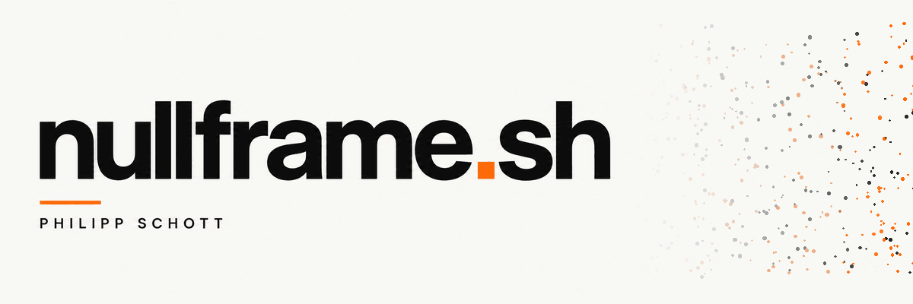

### Fachinformatiker für Anwendungsentwicklung in Umschulung · Kaiserslautern

Seit Mai 2026 mache ich bei WBS TRAINING AG die Umschulung zum Fachinformatiker für Anwendungsentwicklung und suche ab dem 16.08.2027 eine **betriebliche Praxisphase** im Raum Kaiserslautern.

Mit IT beschäftige ich mich seit meiner Jugend: Ich habe Server für Online-Communitys betrieben und über Jahre deren SQL-Datenbanken gepflegt. Heute arbeite ich täglich an eigenen Projekten mit TypeScript, React und Electron und betreibe eigene Linux-Server.

[Portfolio](https://nullframe.sh/) · [Kontakt](mailto:phsc@nullframe.sh)

## eCrampus

Desktop-Client für den Unterrichtsalltag in meiner Umschulung: Kursunterlagen, Berichtsheft, Prüfungsergebnisse und Posteingang der Lernplattform in einer Anwendung, dazu eine Vorbefüllung für das Berichtsheft. eCrampus ist mein eigenständiges Projekt und kein offizielles Angebot der WBS.

* **Nutzung:** Laut integriertem Online-Zähler nutzen 10–12 der 22 Teilnehmenden meines Kurses eCrampus aktiv (Stand Oktober 2026).
* **Technik:** Electron, React und TypeScript mit getrennten Main-, Preload- und Renderer-Prozessen, Sitzungs- und Kontotrennung sowie Hintergrundabfragen mit Windows-Benachrichtigungen.
* **Auslieferung:** über 20 Versionen (1.0 bis 2.5), Windows-Installer und Auto-Update über meinen eigenen Update-Server.

[Live-Demo mit fiktiven Daten](https://nullframe-sh.github.io/ecrampus-showcase/) · [Showcase-Repository](https://github.com/nullframe-sh/ecrampus-showcase) · [Projektvorstellung](projects/ecrampus)

### Meine Arbeit daran

Ich lege fest, welche Funktionen es gibt und wie sie sich bedienen, und arbeite Rückmeldungen aus dem Kurs ein. Fehler verfolge ich über Konsole, Logdateien und Entwicklerwerkzeuge und grenze sie im Code ein. Den Code erstelle ich mit KI-Unterstützung; ich lese ihn dort, wo es auf Logik und Daten ankommt, und prüfe jede neue Version mit automatisierten Tests sowie einem Installations- und Upgrade-Test, bevor ich sie veröffentliche.

## Server und Infrastruktur

Zwei eigene Debian-Server, selbst eingerichtet und betrieben:

* SSH, Docker Compose, Caddy als Webserver, DNS über Cloudflare und TLS-Zertifikate
* eigene Dienste für die eCrampus-Updates, den Online-Zähler und die Kursinhalte, dazu mein Portfolio und das UML Lernstudio
* Fehlersuche direkt im Terminal und in den Logdateien

## Weiteres Projekt

* [UML Lernstudio](https://uml.nullframe.sh/): Webanwendung zum Üben von Anwendungsfall-, Aktivitäts- und Klassendiagrammen mit lokalem Regelcheck. Struktur und Aufbau der Anwendung habe ich festgelegt.

## Hintergrund

Vor der Umschulung war ich acht Jahre ziviler Polizeiangestellter bei den US-Streitkräften. Aus dieser Zeit bringe ich Sorgfalt, Verantwortungsbewusstsein, genaue Dokumentation und sehr gutes Englisch mit.

## Kontakt

Philipp Schott · Kaiserslautern  
[phsc@nullframe.sh](mailto:phsc@nullframe.sh) · [nullframe.sh](https://nullframe.sh/)
