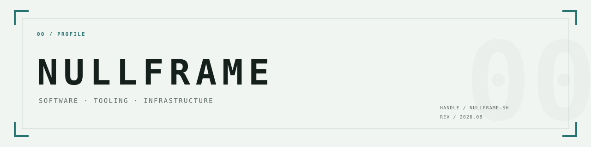

<picture>
  <source media="(prefers-color-scheme: dark)" srcset="./assets/hero-dark.svg">
  <source media="(prefers-color-scheme: light)" srcset="./assets/hero-light.svg">
  
</picture>

# Philipp Schott · nullframe

**Umschüler zum Fachinformatiker für Anwendungsentwicklung bei WBS TRAINING in Kaiserslautern.**  
Ich suche eine **betriebliche Praxisphase / ein Praktikum in der Anwendungsentwicklung** im Raum Kaiserslautern oder remote.

[Portfolio](https://nullframe.sh) · [Live-Demo eCrampus](https://nullframe-sh.github.io/ecrampus-showcase/) · [E-Mail](mailto:phsc@nullframe.sh)

---

## 🚀 Hauptprojekt: eCrampus

Desktop-Client zur Bündelung von Kursmaterialien, Lernangeboten, Prüfungsübersichten und automatisierter Berichtsheftführung für den Ausbildungsalltag.

* 🌐 **[Interaktive Live-Demo](https://nullframe-sh.github.io/ecrampus-showcase/)** – Browser-Showcase der Original-Oberfläche mit fiktiven Mock-Daten
* 📦 **[Showcase-Repository](https://github.com/nullframe-sh/ecrampus-showcase)** – Quellcode des Web-Exports, Bildschirmaufnahmen und Dokumentation
* 📖 **[Ausführliche Case Study](https://github.com/nullframe-sh/nullframe-sh/tree/main/projects/ecrampus)** – Projektentstehung, Anforderungen und Arbeitsweise

**Eckdaten zum Projekt:**
* **Technologie-Stack:** Electron, React und TypeScript (Original-Desktop-Client).
* **Praktische Nutzung:** Aktuell etwa 10–12 täglich aktive Teilnehmer in meinem Kurs mit 22 Personen (eigene Schätzung basierend auf persönlichem Feedback, Stand Oktober 2026).
* **Mein Beitrag:** Ausgangsproblem im eigenen Lernalltag identifiziert, Anforderungen und Schnittstellenverhalten definiert, Umsetzung umfangreich KI-gestützt begleitet, Code-Änderungen manuell geprüft, Fehler systematisch eingegrenzt und mit Kursfeedback iteriert.

---

## 🛠️ Praxis & Eigene Infrastruktur

Neben der Anwendungsentwicklung verwalte ich eigene Server und setze mich praxisnah mit Administration auseinander:
* **Eigene Linux-Server:** Betrieb eines Edge-Servers und eines getrennten Origin-Servers mit Debian 13.
* **Administration & Tools:** Wartung über SSH, Containerisierung mit Docker und Routing über Cloudflare.
* **Arbeitsweise:** Dienste und Konfigurationen erarbeite ich mir eigenständig anhand offizieller technischer Dokumentation.
* **Entwicklungsziel:** Fundierte Vertiefung der Programmierpraxis im Team, sinnvolle Testabdeckung und schrittweiser Ausbau von CI/CD- sowie DevOps-Kenntnissen.

---

## 📂 Weitere Projekte

* **[Bitefight Docker](https://github.com/nullframe-sh/bitefight-docker):** Öffentliches Repository mit einer Docker-Umgebung zur lokalen Ausführung und Entwicklung eines klassischen Browsergame-Codebestands.
* **LectureMind:** Lernplattform zur Strukturierung und Aufbereitung von Kursmaterialien (in Entwicklung).

---

## 👤 Werdegang & Hintergrund

* **Seit Mai 2026:** Umschulung zum Fachinformatiker für Anwendungsentwicklung (FIAE) bei WBS TRAINING.
* **Beruflicher Hintergrund:** Mehrjährige Vorerfahrung als ziviler Polizeimitarbeiter bei den US-Streitkräften – geprägt von Verantwortungsbewusstsein, klaren Abläufen, sorgfältiger Dokumentation und verlässlicher Teamarbeit.
* **Technisches Interesse:** Früher Einstieg durch private Serverprojekte und relationale Datenbanken (SQL).

---

## 📬 Kontakt

**Philipp Schott** · Kaiserslautern  
[phsc@nullframe.sh](mailto:phsc@nullframe.sh) · [nullframe.sh](https://nullframe.sh) · [GitHub](https://github.com/nullframe-sh)
